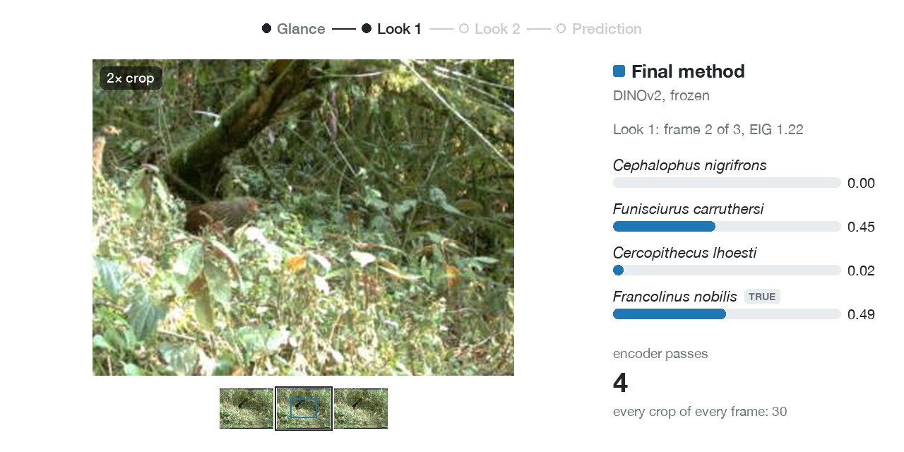

# Intelligent Eyes

Teaching frozen ViT models where to look in video.

[](https://da-dawit.github.io/intelligent-eyes/)

Models like CLIP and DINOv2 shrink every frame to 224 px, so a small animal far away in a camera trap
can get lost. My idea is to glance at every frame once, then zoom (2x) only into the few crops that
are expected to tell the model the most, using Bayes' rule and expected information gain. Nothing is
fine-tuned. The encoders stay frozen, and I only train linear heads and a small ridge regression.

**Videos and all results are on the [project page](https://da-dawit.github.io/intelligent-eyes/)!**

## Results

iWildCam test set (3,930 clips from 48 cameras never seen in training), clip accuracy (%), mean of 3 seeds.

| encoder | glance only | + 2 looks | every crop of every frame (10x the cost) |
|---|---|---|---|
| CLIP | 67.1 | **76.4** | 75.1 |
| DINOv2 | 81.6 | **86.1** | 86.0 |
| DINOv3 | 78.2 | **84.1** | 84.2 |
| SigLIP 2 | 69.3 | **78.9** | 77.6 |

Two looks give +4.5 to +9.6 points and match zooming into everything. Full numbers are in
[results/iwildcam/summary_final.md](results/iwildcam/summary_final.md). On DDR retina photos the looks
don't help yet, which is what I'm fixing next.

## Run it

```bash
uv venv --python 3.11 .venv
uv pip install --python .venv/bin/python -e ".[dev]"
.venv/bin/python -m pytest          # 43 tests: derivations, new pieces, controller on synthetic clips
PYTHONPATH=. .venv/bin/python scripts/synthetic_study.py    # the method on synthetic clips
```

These two need no data. Dependencies are in `pyproject.toml`: Python 3.11, PyTorch ≥ 2.5, torchvision,
Transformers ≥ 4.56, safetensors, NumPy, SciPy, pandas, scikit-learn, Pillow, Matplotlib, tqdm and pytest.
ffmpeg is only needed to remake the videos, and a GPU (CUDA or Apple MPS) helps for encoding.

<details>
<summary>Full pipeline on real data</summary>

Data lives outside the repo, in `../data` by default (set `EYES_DATA` to move it).

```bash
export PYTHONPATH=.
# 0. data: WILDS iWildCam v2.0 (12 GB, frames 448 px tall). The downloader is parallel,
#    resumable across dropped connections, and checks the SHA-256.
python scripts/download.py \
    https://huggingface.co/datasets/pangwei/wilds-iwildcam/resolve/78b5e7d858adb01cb5661c7b5f8666a4e91be2cb/iwildcam_v2.0.tar.gz \
    $EYES_DATA/raw/iwildcam_v2.0.tar.gz --sha256 05c872f46eee44315f79bc90f4098c69ae3799a2b95116db02292ea1b4e370d2
mkdir -p $EYES_DATA/raw/iwildcam_v2.0    # the archive has no top-level folder
tar xzf $EYES_DATA/raw/iwildcam_v2.0.tar.gz -C $EYES_DATA/raw/iwildcam_v2.0

# 1. clips: WILDS sequences -> bursts of 1-10 frames, one species each
python scripts/build_clips.py --dataset iwildcam --root $EYES_DATA/raw/iwildcam_v2.0 \
    --out $EYES_DATA/processed/iwildcam

# 2. encode every frame once: glance, 9 crops, crop previews, CLS attention, and (--hires)
#    the whole frame at 2x for baseline B1. Each frame is decoded once for all encoders listed.
python scripts/cache_features.py --frames $EYES_DATA/processed/iwildcam/frames.csv \
    --images $EYES_DATA/raw/iwildcam_v2.0 --encoders dinov2 clip siglip2 dinov3 --hires \
    --out-root $EYES_DATA/features/iwildcam

# 3. animal boxes for the crop labels (82 MB, read out of the 169 GB LILA archive by range requests)
python scripts/fetch_boxes.py --out $EYES_DATA/raw/iwildcam_mdv4

# 4. fit on 10% held-out training cameras, run every method on the test clips, 3 seeds.
#    The final method; drop the flags for the method exactly as proposed.
python scripts/run_eval.py --dataset iwildcam --encoder dinov2 --seeds 0 1 2 \
    --crop-labels boxes --predictor preview --vote-shape none --fusion gated --crop-effect fit

# 5. Table I of the proposal + accuracy-vs-passes figure
python scripts/summarize.py --dataset iwildcam
```

DDR runs the same steps with `--dataset ddr`, after this download:

```bash
python -c "from huggingface_hub import snapshot_download; snapshot_download('YBoWen/DDR-dataset', \
    repo_type='dataset', revision='cc2af821dbde42c545fd854d8e675c3bb74ca265', \
    allow_patterns=['DR_grading/*'], local_dir='$EYES_DATA/raw/ddr')"
python scripts/build_clips.py --dataset ddr --root $EYES_DATA/raw/ddr --out $EYES_DATA/processed/ddr
```

Encoders: `clip`, `siglip2`, `dinov2`, `dinov3` (all ViT-B). DINOv3 is gated on Hugging Face, so accept
its licence and run `hf auth login` first. I did the full runs on one rented RTX PRO 6000 with
[scripts/cloud_run.sh](scripts/cloud_run.sh).

</details>

## Where things are

- `eyes/` is the method. `belief.py` combines the votes (eq. 1), `correlation.py` fits R,
  `predictor.py` predicts a look before taking it (eq. 2), `eig.py` scores it (eq. 3) and
  `controller.py` runs the glance, look, stop loop.
- `scripts/` builds the clips, encodes the frames, runs the evaluation and makes the figures and videos.
- `tests/` checks the math against the code.
- `results/` has the saved summaries of every run.
- `docs/` has the proposal, the midpoint memo and the project page.

What changed from the proposal, and the first failure I had to fix, are in the
[midpoint memo](docs/midpoint_memo.pdf).

DA411 Computational Mathematics, final project (Option A), Dawit Chun.
Data: iWildCam via WILDS and the MegaDetector boxes (CDLA-Permissive), DDR (CC BY-NC-SA 4.0).
The encoders are used frozen under their own licences.
